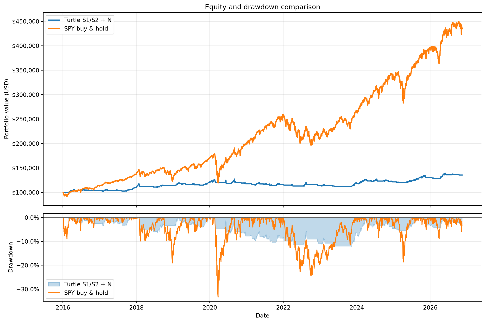
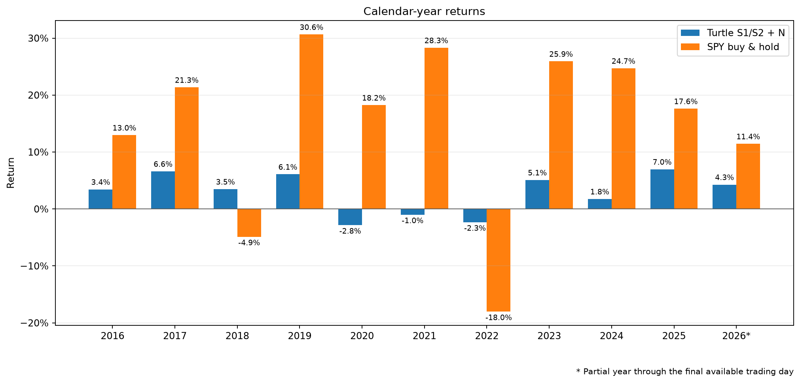

# SPY Turtle S1/S2 Backtest

一个使用 Python 编写的 SPY 日线、只做多、无杠杆海龟交易系统回测项目。

项目实现 System 1 盈利突破过滤和 System 2 Fail-safe 入场，并使用经典海龟的波动率指标 `N`、单位规模、`2N` 初始止损和 `0.5N` 加仓规则。由于这是现金股票账户而不是期货保证金账户，最终仓位仍受现金与总名义金额限制。

> 本项目仅用于编程和策略研究，不构成投资建议。历史回测不代表未来表现。

## 回测图表

### 资金曲线与回撤



### 分年度收益



## 策略规则

- 标的：SPY
- 周期：日线
- 方向：只做多
- 初始资金：100,000 美元
- System 1：突破前 20 日最高价入场，跌破前 10 日最低价退出
- System 1 过滤：前一次理论突破盈利时跳过下一次 20 日突破
- System 2 Fail-safe：跳过 System 1 后，突破前 55 日最高价入场，跌破前 20 日最低价退出
- `N`：20 日 Wilder/指数平滑真实波幅，盘中决策使用上一交易日已经完成计算的数值
- 经典单位目标：`账户权益 × 1% ÷ N`
- 初始止损：入场价下方 `2N`
- 加仓：从上一次实际成交价开始，每上涨 `0.5N` 加一个单位
- 最大单位数：4
- 最大总买入名义金额：98,000 美元
- 滑点：买卖各 5 个基点

日线数据无法确定同一天内高点和低点的先后顺序。出现入场、加仓和止损冲突时，回测采用确定且偏保守的不利成交顺序。

## 当前结果

数据范围为 2016-01-04 至 2026-11-13，2026 年不是完整年度。

| 指标 | 海龟 S1/S2 + N | SPY 买入持有 |
|---|---:|---:|
| 初始资金 | $100,000.00 | $100,000.00 |
| 最终资产 | $135,641.39 | $435,831.56 |
| 总收益率 | 35.64% | 335.83% |
| 年化收益率 | 2.85% | 14.52% |
| 最大回撤 | -12.15% | -33.40% |
| 夏普比率（无风险利率为 0） | 0.55 | 0.87 |

回测未计入佣金、税费和闲置现金利息。价格使用 Alpaca 提供的复权日线数据。

### 无杠杆约束的影响

为了给最多 4 个单位预留现金，每个单位最多使用约 24,500 美元。因此当前样本中的初始单位全部受到现金/名义金额上限约束，实际单个 `N` 对应的权益波动低于经典目标的 1%。这是现金账户版本与原始期货海龟系统的重要差异。

## 项目结构

```text
donchian_spy/
├── src/
│   ├── data.py          # Alpaca 数据下载与验证
│   ├── strategy.py      # 唐奇安通道信号
│   ├── risk.py          # N、单位规模、止损与加仓
│   ├── backtest.py      # 逐日回测引擎
│   └── reporting.py     # 指标、买入持有和图表
├── tests/               # 自动化测试
├── outputs/             # 本地生成结果；Git 只跟踪两张示例图
├── backtest_report.ipynb
├── run_backtest.py
├── requirements.txt
└── .env.example
```

原始行情文件、回测 CSV/JSON、虚拟环境和 `.env` 密钥文件不会提交到 Git。

## 安装

以下命令在 Windows PowerShell 中执行：

```powershell
git clone https://github.com/YOUR_USERNAME/YOUR_REPOSITORY.git
cd YOUR_REPOSITORY

py -3.13 -m venv .venv
.\.venv\Scripts\Activate.ps1
python -m pip install -r requirements.txt
```

如果 PowerShell 阻止激活脚本，可以只对当前终端临时调整：

```powershell
Set-ExecutionPolicy -Scope Process -ExecutionPolicy RemoteSigned
.\.venv\Scripts\Activate.ps1
```

## 配置 Alpaca 数据凭据

复制环境变量模板：

```powershell
Copy-Item .env.example .env
```

在本地 `.env` 中填写：

```text
ALPACA_API_KEY=
ALPACA_SECRET_KEY=
```

在本地文件中分别把 Key 和 Secret 填在等号后面。

不要把 `.env` 上传到 GitHub。项目只会提交不含真实密钥的 `.env.example`。

## 下载数据

在项目根目录执行：

```powershell
python -m src.data
```

数据会保存到被 Git 忽略的 `data/raw/`。

## 运行回测

```powershell
python run_backtest.py
```

回测会生成资金曲线、成交记录、汇总指标、买入持有基准、年度表现和 PNG 图表。

若希望图表直接显示在代码下方，请在 VSCode 中打开 `backtest_report.ipynb`，选择项目 `.venv` 解释器后运行全部单元格。

## 测试与代码检查

```powershell
python -m pytest -q
python -m ruff check src tests run_backtest.py backtest_report.ipynb
```

当前测试数量：39。

## 数据与结果可复现性

原始行情快照不会提交到仓库，因此未来重新下载时，数据结束日期或供应商历史修订可能造成结果变化。README 中展示的是上述固定数据范围对应的当前本地结果。

## 许可证

当前尚未添加开源许可证。在添加许可证之前，代码默认不授予他人复制、修改或分发的权利。
