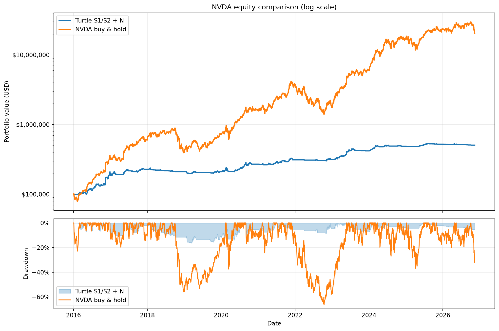
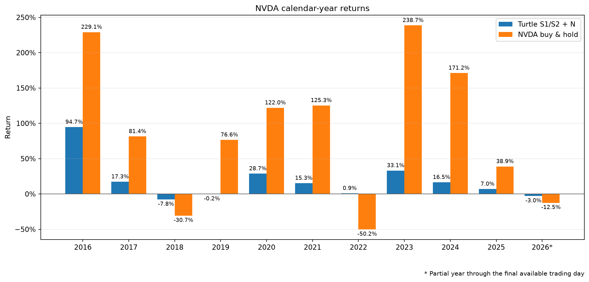
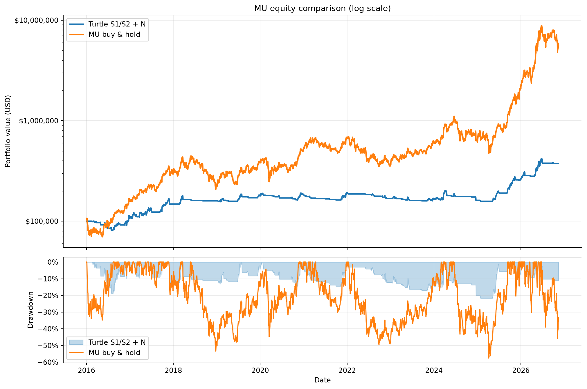
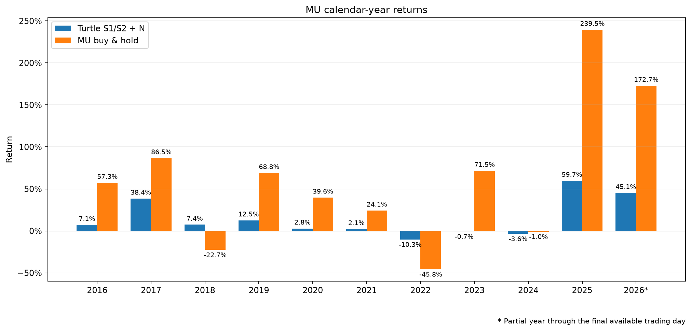
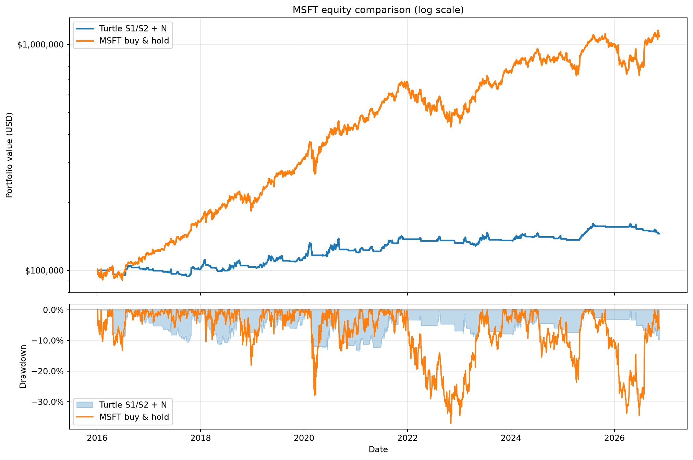
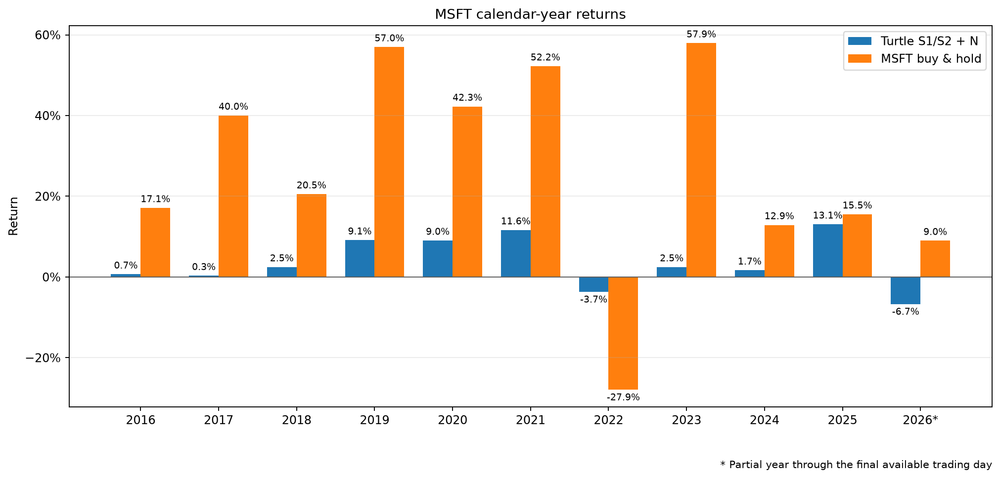

# Quant Strategy Lab: Turtle、Alpha 与风险组合研究

使用 Python 构建的美股日线研究项目：包含多标的海龟 S1/S2 回测、短期均值回归 Alpha、事件风险覆盖层，以及受风险约束的组合回测。数据来自 Twelve Data、SEC EDGAR 与 Marketaux；当前研究标的为 NVDA、MU 和 MSFT。

> 仅供编程与策略研究，不构成投资建议。历史回测不代表未来表现。

项目实现 System 1 盈利突破过滤和 System 2 Fail-safe 入场，并使用经典海龟的波动率指标 `N`、单位规模、`2N` 初始止损和 `0.5N` 加仓规则。由于这是现金股票账户而不是期货保证金账户，最终仓位仍受现金与总名义金额限制。

## 回测图表

### NVDA





### MU





### MSFT





## 策略规则

- 标的：NVDA、MU、MSFT，分别独立运行
- 周期：日线
- 方向：只做多
- 初始资金：每只股票 100,000 美元
- System 1：突破前 20 日最高价入场，跌破前 10 日最低价退出
- System 1 过滤：前一次理论突破盈利时跳过下一次 20 日突破
- System 2 Fail-safe：跳过 System 1 后，突破前 55 日最高价入场，跌破前 20 日最低价退出
- `N`：20 日 Wilder/指数平滑真实波幅，盘中决策使用上一交易日已经完成计算的数值
- 经典单位目标：`账户权益 × 1% ÷ N`
- 初始止损：入场价下方 `2N`
- 加仓：从上一次实际成交价开始，每上涨 `0.5N` 加一个单位
- 最大单位数：4
- 最大总买入名义金额：98,000 美元
- 滑点：买卖各 5 个基点

日线数据无法确定同一天内高点和低点的先后顺序。出现入场、加仓和止损冲突时，回测采用确定且偏保守的不利成交顺序。

## 当前结果

数据范围为 2016-01-04 至 2026-11-13，2026 年不是完整年度。

| 标的 | 组合 | 最终资产 | 总收益率 | 年化收益率 | 最大回撤 | 夏普比率 |
|---|---|---:|---:|---:|---:|---:|
| NVDA | 海龟 S1/S2 + N | $506,645.73 | 406.65% | 16.12% | -16.33% | 1.08 |
| NVDA | 买入持有 | $20,301,415.62 | 20,201.42% | 63.12% | -66.29% | 1.24 |
| MU | 海龟 S1/S2 + N | $373,681.46 | 273.68% | 12.91% | -21.73% | 0.78 |
| MU | 买入持有 | $5,657,205.81 | 5,557.21% | 45.01% | -57.52% | 0.97 |
| MSFT | 海龟 S1/S2 + N | $145,357.29 | 45.36% | 3.50% | -13.55% | 0.38 |
| MSFT | 买入持有 | $1,087,507.68 | 987.51% | 24.58% | -37.04% | 0.94 |

回测未计入佣金、税费和闲置现金利息。上表和示例图仍来自迁移前保存的固定行情快照；新的数据下载器已经切换到 Twelve Data，重新下载并回测后结果可能变化。

### 无杠杆约束的影响

为了给最多 4 个单位预留现金，每个单位最多使用约 24,500 美元。因此当前样本中的初始单位全部受到现金/名义金额上限约束，实际单个 `N` 对应的权益波动低于经典目标的 1%。这是现金账户版本与原始期货海龟系统的重要差异。

## 项目结构

```text
quant-strategy-lab-twelve-sec-marketaux/
├── src/
│   ├── alpha.py         # 均值回归 Alpha 构建与前瞻收益诊断
│   ├── data.py          # Twelve Data 复权日线下载与验证
│   ├── event_risk.py    # 隔夜跳空、新闻时间映射与事件风险覆盖层
│   ├── filings.py       # SEC EDGAR 官方申报元数据与历史文件
│   ├── news.py          # Marketaux 近期新闻增量归档
│   ├── portfolio_risk.py # EWMA 协方差、风险预算与组合仓位
│   ├── strategy.py      # 唐奇安通道信号
│   ├── risk.py          # N、单位规模、止损与加仓
│   ├── backtest.py      # 逐日回测引擎
│   └── reporting.py     # 指标、买入持有和图表
├── tests/               # 自动化测试
├── outputs/             # 运行结果；Git 仅跟踪 README 使用的六张示例图
├── backtest_report.ipynb
├── run_alpha_research.py
├── run_alpha_portfolio_backtest.py
├── run_risk_model.py
├── run_backtest.py
├── requirements.txt
└── .env.example
```

原始行情文件、回测 CSV/JSON、编辑器配置、虚拟环境和 `.env` 密钥文件不会提交到 Git。

## 安装

以下命令在 macOS 终端中执行：

```bash
git clone https://github.com/YOUR_USERNAME/YOUR_REPOSITORY.git
cd YOUR_REPOSITORY

python3 -m venv .venv
source .venv/bin/activate
python -m pip install -r requirements.txt
```

## 配置数据源

项目不再依赖 Alpaca 登录。现在使用三类数据源：

- Twelve Data：复权日线 OHLCV；
- SEC EDGAR：10-K、10-Q、8-K 等官方申报，API 本身不需要密钥；
- Marketaux：近期新闻增量归档，用于事件风险提示。

复制环境变量模板：

```bash
cp .env.example .env
```

在本地 `.env` 中填写：

```text
TWELVE_DATA_API_KEY=你的 Twelve Data API Key
MARKETAUX_API_TOKEN=你的 Marketaux API Token
SEC_USER_AGENT=你的姓名或项目名 your-email@example.com
```

`SEC_USER_AGENT` 是 SEC 要求的联系标识，不是密钥。为了避免泄露，不要把真实 Key 或 Token 发到聊天中，直接填进本机 `.env` 即可。

不要把 `.env` 上传到 GitHub。项目只会提交不含真实密钥的 `.env.example`。

## 下载数据

在项目根目录执行：

```bash
python -m src.data
python -m src.filings
python -m src.news
```

数据会保存到被 Git 忽略的 `data/raw/`。Twelve Data 下载从 2016 年开始的日线；SEC 下载同一研究期内的官方申报；Marketaux 免费层更适合每天增量收集近期新闻，不能视为完整的 2016 年以来历史新闻库。

## 运行回测

```bash
python run_backtest.py
```

回测会生成资金曲线、成交记录、汇总指标、买入持有基准、年度表现和 PNG 图表。

## 构建均值回归 Alpha

项目包含一个只使用现有复权日线收盘价和成交量的短期均值回归 Alpha：

- 用 5 日收益表示短期价格冲击；
- 用前 20 日已完成的日收益波动率进行风险标准化；
- 用当前成交量相对前 20 日历史的异常程度增强流动性冲击置信度；
- 仅在收盘价高于前 200 日均线时保留只做多信号；
- 输出范围为 0 到 1 的连续 `AlphaScore`，供后续组合构建使用。

所有滚动参考统计量都滞后一日。模型可以使用当日完整收盘数据，但只能在下一交易日或之后执行，不能假设成交在产生信号的同一个收盘价。

下载原始数据后运行：

```bash
python run_alpha_research.py
```

事件风险层按照新闻或 SEC 申报的真实发布时间，映射到下次开盘前可用的交易决策：一般负面事件降低 Alpha，疑似重大基本面事件将 `EventAdjustedAlpha` 归零并设置 `RequiresManualReview`，大幅隔夜向下跳空也会降低 Alpha。关键词和申报条目只负责产生可审计的风险候选，不代表模型已经证明基本面永久受损。

结果保存在 `outputs/alpha/`，包括每只股票的完整信号历史，以及价格 Alpha 和事件调整 Alpha 各自的 1/5/10 日前瞻收益相关性、激活样本平均收益和命中率。这些诊断用于判断 Alpha 是否包含预测信息，不代表包含滑点和持仓约束的可交易策略收益。

## 构建组合风险模型

Alpha 生成后运行：

```bash
python run_risk_model.py
```

风险模型使用日频对数收益和衰减系数 0.94 的 EWMA 协方差，并将相关矩阵向单位阵收缩 25%，降低三只高相关科技股带来的估计不稳定性。组合权重先按 `事件调整 Alpha ÷ 年化波动率` 分配，最强 AlphaScore 同时控制总信号仓位，再执行以下约束：

- 目标年化波动率：10%；
- 单只股票权重上限：40%；
- 总股票仓位上限：100%，不使用杠杆；
- 无合格信号或风险过高时保留现金；
- 日期 `t` 的权重最早只能在 `t+1` 执行。

结果保存在 `outputs/risk/`，包括完整风险历史、最新协方差/相关矩阵和最新风险报告。报告同时给出参数法 95% 单日 VaR、95% Expected Shortfall，以及用当前权重重放最近 252 个交易日的历史压力结果。

## 风险权重组合回测

```bash
python run_alpha_portfolio_backtest.py
```

回测严格按照收盘后生成信号、下一交易日开盘调仓、持有至再下一交易日开盘的顺序计算。换仓按单边 5 个基点扣费，并依据价格变化后的漂移仓位计算真实换手。报告将样本分为 2016–2022 研究期、2023–2024 验证期和 2025 年至今测试期，对比：

- 纯价格 Alpha + 风险模型；
- 事件调整 Alpha + 风险模型；
- 不使用 Alpha 的逆波动风险基准；
- 三只股票等权买入持有。

结果保存在 `outputs/alpha_portfolio/`，包含逐日仓位与净值、分阶段指标和测试期净值/回撤图。

若希望图表直接显示在代码下方，请在 VSCode 中打开 `backtest_report.ipynb`，选择项目 `.venv` 解释器后运行全部单元格。

## 测试与代码检查

```bash
python -m pytest -q
python -m ruff check src tests run_backtest.py backtest_report.ipynb
```

当前测试数量：72。

## 数据与结果可复现性

原始行情快照不会提交到仓库，因此未来重新下载时，数据结束日期或供应商历史修订可能造成结果变化。README 中展示的是上述固定数据范围对应的当前本地结果。

## 许可证

当前尚未添加开源许可证。在添加许可证之前，代码默认不授予他人复制、修改或分发的权利。
